# Informe integral de resultados y conclusiones

**Proyecto:** modelo estructural, rotodinámico y sísmico de un aerogenerador  
**Fecha del informe:** 9 de septiembre de 2026  
**Unidades:** Sistema Internacional (SI)  

## 1. Conclusión ejecutiva

La cadena de cálculo parte de los datos heredados, construye un modelo de vigas
Timoshenko 3D con masa consistente, impone restricciones rígidas exactas,
incorpora masas espaciales, resuelve el equilibrio con gravedad y
centrifugación, forma los operadores dinámicos, obtiene los autovalores del
sistema rotante y finalmente integra la respuesta sísmica multicomponente con
Newmark. El informe se concentra en las magnitudes calculadas, en el significado
físico de cada una y en su comparación con el valor analítico o el orden
numérico esperado.

La conclusión científicamente defendible es doble:

1. **Sí puede afirmarse** que la discretización representa un sistema
   conectado, que sus operadores cumplen las propiedades mecánicas esperadas y
   que las soluciones convergen hacia referencias conocidas con errores
   cuantificados.
2. **Todavía no puede afirmarse** que los desplazamientos, frecuencias
   operativas, esfuerzos de viento o respuestas sísmicas sean predicciones
   calibradas de una turbina comercial concreta. Faltan rigidez y
   amortiguamiento medidos del tren, offsets reales de centros de masa,
   coeficientes aerodinámicos, una cimentación calibrada y una demanda sísmica
   normativa.

La frase “el caso primitivo tiene únicamente seis frecuencias naturales” debe
precisarse. El elemento de dos nodos tiene 12 coordenadas: aparecen
**exactamente seis modos de cuerpo rígido con frecuencia cero** y
**exactamente seis modos deformacionales con frecuencia positiva**. No hay 12
frecuencias elásticas independientes ni modos espurios adicionales. En el
modelo global libre–libre conectado también existen exactamente seis modos
rígidos globales, pero después de ellos hay muchos modos flexibles. Al fijar la
base desaparecen los seis ceros.

## 2. Alcance físico y lectura de las métricas

No todas las cifras tienen el mismo alcance. Las frecuencias, desplazamientos,
reacciones y fuerzas internas son respuestas del modelo definido; los errores
relativos indican cuánto se aparta un cálculo de una referencia conocida; y los
criterios esperados fijan la precisión necesaria para interpretar el resultado
sin que el error de discretización domine la comparación.

| Resultado | Qué representa | Alcance |
|---|---|---|
| Frecuencias y formas modales | propiedades dinámicas del modelo linealizado | dependen de masa, rigidez, apoyo y punto operativo |
| Campbell y amortiguamiento modal | evolución de las ramas con la velocidad | usa azimut congelado y un espectro parcial |
| Respuesta sísmica | incremento dinámico alrededor del equilibrio | usa un movimiento sintético, no un sismo de diseño |
| Error relativo | distancia adimensional al valor de referencia | mide exactitud numérica, no incertidumbre física |
| Valor esperado | orden, tolerancia o referencia analítica | permite decidir si la resolución es suficiente |
| Carga de viento | fuerza generalizada dependiente del estado | la interfaz existe, pero en el caso físico actual es nula |

Para una magnitud escalar $x$ con referencia $x_{\mathrm{ref}}$, se usa

\[
\varepsilon_{\mathrm{rel}}
=\frac{|x-x_{\mathrm{ref}}|}
{\max\!\left(|x_{\mathrm{ref}}|,\epsilon\right)}.
\]

Cuando se comparan matrices o vectores se emplea la norma euclídea o de
Frobenius en numerador y denominador. Un criterio como
$\varepsilon_{\mathrm{rel}}\leq10^{-3}$ significa un error máximo de 0.1%;
no significa que los parámetros físicos de la turbina tengan esa precisión.

## 3. Proceso completo de conversión de la malla heredada

### 3.1 Datos de partida y transformación

La conversión toma las coordenadas, conectividades, ejes auxiliares, secciones,
masas e inercias de Version 0 y los transforma una sola vez a estructuras
MAT/JSON en unidades SI. El análisis moderno opera sobre esos datos ya
convertidos; por tanto, no modifica la geometría mientras ensambla las matrices.

Los datos crudos de Version 0 son:

- `coordinates`: 138 filas × 3 coordenadas;
- `connectivity`: 137 filas × 4 columnas
  `[id_elemento, tipo_heredado, nodo_I, nodo_J]`;
- `coorP1aux`, `coorP2aux`, `coorP3aux`: 36 × 3 cada uno;
- 55 secciones convertidas a SI;
- masas e inercias de góndola y cubo en un JSON trazable.

Cada pala tiene 35 elementos. Por eso solo se usan las filas 1–35 del arreglo
auxiliar correspondiente; la fila 36 se conserva como dato heredado, pero no se
asigna artificialmente.

### 3.2 Clasificación y filtrado de conectividad

La conversión de `model.build_model` conserva todos los nodos y clasifica los
elementos por el tipo heredado:

| Tipo heredado | IDs | Tratamiento moderno | Cantidad activa |
|---:|---|---|---:|
| 1 | 1–19 | Torre flexible; sección igual al ID heredado | 19 |
| 2 | 20–124 | Tres palas flexibles, 35 elementos por pala | 105 |
| 3 | 134–137 | Conectores de penalización retirados | 0 |
| 4 | 125–133 | Transiciones flexibles heredadas; sección 20 | 9 |

Los cuatro tipo 3 eran un enlace góndola–cubo y tres enlaces cubo–raíz. No se
mantuvieron como vigas extremadamente rígidas porque una penalización contamina
el condicionamiento y puede crear modos numéricos. Su función cinemática se
reemplazó por MPC exactas donde correspondía y por un constitutivo flexible de
tren entre los maestros 129 y 130. Los nueve tipo 4 sí permanecieron: aportan
7.1905 m y 26,488.80 kg, pero su significado físico sigue siendo una hipótesis
heredada, no una identificación del eje o de los cojinetes.

La correspondencia de estaciones de pala es explícita:

| Pala | IDs de elemento heredado | Estación | Sección moderna | Auxiliar |
|---:|---|---|---|---|
| 1 | 20–54 | `id−19` | `20+estación` | `coorP1aux` |
| 2 | 55–89 | `id−54` | `20+estación` | `coorP2aux` |
| 3 | 90–124 | `id−89` | `20+estación` | `coorP3aux` |

No se regeneraron coordenadas ni se interpoló una geometría nueva: la malla
física final es la malla heredada convertida, con **138 nodos y 133 elementos
flexibles activos**.

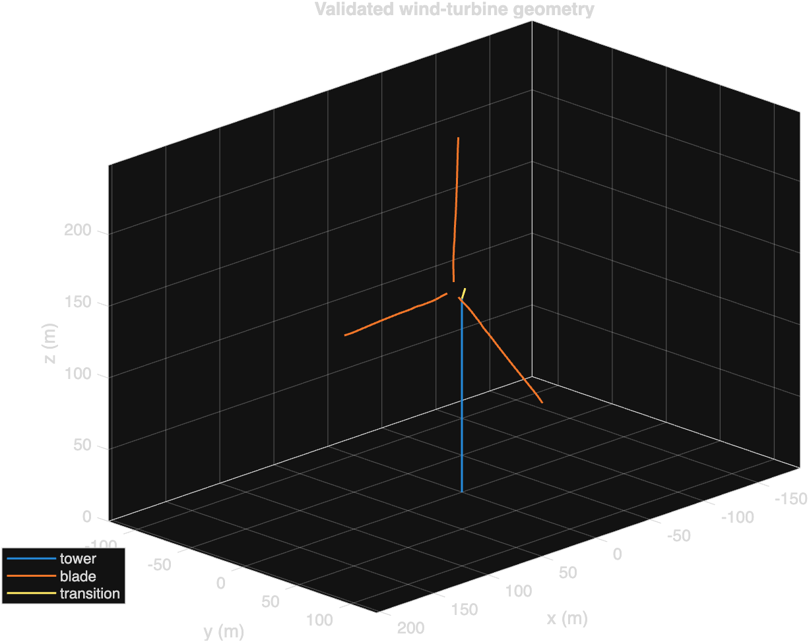

*Figura 1. Geometría heredada convertida. Se conservan torre, tres palas,
góndola/rotor y transiciones; se eliminan solo los cuatro conectores de
penalización.*

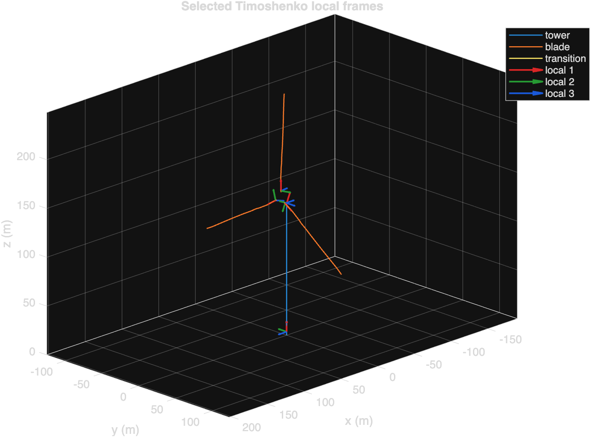

*Figura 2. Ejes locales obtenidos con auxiliares independientes P1/P2/P3. La
orientación no se infiere copiando la de una sola pala.*

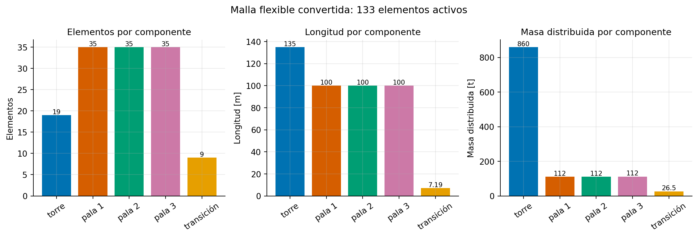

*Figura 3. Recuento, longitud y masa distribuida por componente. Las 105 vigas
de pala se dividen en tres conjuntos homólogos de 35.*

### 3.3 Conversión de secciones

Las secciones 1–20 corresponden a torre/transición. Se obtienen a partir de
`secc_torre` y las constantes heredadas `E=2.1e11 Pa`, `nu=0.3` y
`rho=7850 kg/m³`. Las secciones 21–55 son las 35 estaciones de pala. Para ellas
se conservan directamente las seis rigideces generalizadas
`EA, GAy, GAz, GJ, EIy, EIz`; no se inventan un módulo y un área equivalentes.

Version 0 entrega para la masa de pala las columnas `AXIALD`, `TORDEN`,
`INERT2` e `INERT3`. Como `TORDEN=0` en todas las estaciones, el dato importado
importado deja `Jx=NaN` y obliga a elegir una regla explícita. La configuración
empleada usa el teorema de ejes perpendiculares,

\[
J_x=J_y+J_z,
\]

sin intentar deducirlo de `EA`, `GJ` o un módulo efectivo. Version 0 tampoco
entrega offsets del centroide; se documenta `ycg=zcg=0` como supuesto.

### 3.4 Distinción entre conversión y convergencia de malla

La conversión anterior reproduce la topología disponible. El estudio de
convergencia es un análisis separado: usa
una **viga uniforme sintética de 12 m** discretizada con 1, 2, 4, 8, 16, 32 y
64 elementos. Esta separación es importante: el refinamiento sintético caracteriza
el elemento sin inventar estaciones adicionales dentro de la turbina heredada.
No se ha realizado todavía una campaña de refinamiento geométrico de la turbina
completa con propiedades interpoladas.

## 4. Formulación elemental Timoshenko 3D

### 4.1 Cinemática, ejes y energía

Cada nodo tiene seis GDL ordenados como tres traslaciones y tres rotaciones.
Para el elemento de dos nodos, $\bm q_e$ tiene 12 componentes. El eje local
$\bm e_1$ va de I a J. El vector hacia el punto auxiliar se proyecta sobre el
plano normal a $\bm e_1$ para definir $\bm e_3$, y la base dextrógira se completa
con $\bm e_2=\bm e_3\times\bm e_1$.

La deformación generalizada reúne axial, dos cortantes, torsión y dos
curvaturas. La energía se escribe como

\[
U_e=\frac{1}{2}\int_0^L
\bm\varepsilon(\bm q_e)^T\bm C_{\mathrm{sec}}
\bm\varepsilon(\bm q_e)\,\mathrm dx,
\]

donde $\bm C_{\mathrm{sec}}$ contiene las seis rigideces generalizadas
positivas de la sección. La matriz elemental resulta de

\[
\bm K_e=\int_0^L\bm B^T\bm C_{\mathrm{sec}}\bm B\,\mathrm dx,
\qquad
\bm\varepsilon=\bm B\bm q_e.
\]

La formulación cerrada exacta se usa en los resultados de la turbina. La
integración selectiva emplea dos puntos de Gauss para los términos normales y
uno para cortante, y se usa en el estudio de convergencia espacial.

La masa consistente integra traslación del centroide, inercia rotacional y el
acoplamiento que produciría una excentricidad. No se diagonaliza de forma
silenciosa.

### 4.2 Demostración de los seis modos del elemento primitivo

La demostración no se basa solo en observar una gráfica. Se usaron cuatro argumentos
complementarios sobre un elemento sintético bien condicionado de longitud 5 m:

| Propiedad primitiva | Valor | Unidad |
|---|---:|---|
| Longitud `L` | 5 | m |
| Rigidez axial `EA` | `2.1e9` | N |
| Rigideces de cortante `GAy`, `GAz` | `4.0e8`, `3.0e8` | N |
| Rigidez torsional `GJ` | `1.5e8` | N·m² |
| Rigideces de flexión `EIy`, `EIz` | `8.0e7`, `6.0e7` | N·m² |
| Masa lineal `m` | 25 | kg/m |
| Inercias lineales `Jx`, `Jy`, `Jz` | 2.0, 1.2, 1.4 | kg·m |
| Offset del centro de masa `ycg`, `zcg` | 0, 0 | m |

Estos valores no representan una sección particular de la turbina: forman un
caso unitario reproducible, positivo y sin excentricidad, elegido para aislar la
estructura algebraica del elemento.

1. **Conteo cinemático.** Hay 12 coordenadas nodales y seis deformaciones
   independientes. Un movimiento euclídeo 3D posee tres traslaciones y tres
   rotaciones; por tanto, el subespacio rígido esperado tiene dimensión 6.
2. **Construcción explícita.** Se construyó $Q\in\mathbb{R}^{12\times6}$ con
   tres traslaciones uniformes y tres rotaciones infinitesimales, usando
   $u(x)=t+\theta\times x$ y la misma rotación $\theta$ en ambos nodos. El
   residuo energético normalizado fue
   $\lVert KQ\rVert/(\lVert K\rVert\lVert Q\rVert)=2.691\times10^{-18}$.

En bloques de tres componentes y con el orden nodal
$q_e=[u_i,\theta_i,u_j,\theta_j]^T$, la base rígida utilizada es

\[
Q=\begin{bmatrix}
I_3 & -[x_i]_\times\\
0   & I_3\\
I_3 & -[x_j]_\times\\
0   & I_3
\end{bmatrix},
\qquad
u_k=t+\theta\times x_k=t-[x_k]_\times\theta.
\]

Para el sistema local primitivo se tomó $x_i=0$ y $x_j=L e_1$. Las seis
columnas de $Q$ son linealmente independientes, no producen deformación y por
eso deben pertenecer al núcleo de $K$. La SVD demuestra además que el núcleo no
contiene ninguna dirección adicional.
3. **Rango–nulidad.** La SVD normalizada de `K` muestra seis valores singulares
   materiales y seis nulos: `rank(K)=6`, `nullity(K)=6`. Como la matriz de masa
   es definida positiva por Cholesky, el problema generalizado no puede ocultar
   coordenadas sin masa. En la corrida reproducida, `cholFlag=0` y
   `min(eig(M))=1.5311`, ambos consistentes con `M` definida positiva.
4. **Espectro generalizado.** Al resolver
   $\bm K\bm\phi_i=\mu_i\bm M\bm\phi_i$ sin formar
   $\bm M^{-1}$ aparecen seis
   valores numéricamente nulos, todos con
   $|f|\leq1.596\times10^{-5}\,\mathrm{Hz}$, por debajo de la tolerancia
   $10^{-4}\,\mathrm{Hz}$, y luego seis frecuencias positivas. No aparece
   ningún autovalor materialmente negativo. Los modos se normalizan con
   $\bm\phi_i^H\bm M\bm\phi_i=1$.

Aquí $\mu=\omega^2$ y, para los autovalores positivos,
$f=\sqrt{\mu}/(2\pi)$. Para representar perturbaciones cercanas a cero se
conserva el signo de $\mu$ y se grafica
$\operatorname{sign}(\mu)\sqrt{|\mu|}/(2\pi)$; este recurso gráfico no convierte
los ceros de redondeo en frecuencias físicas.

| Grupo | Frecuencias [Hz] | Interpretación |
|---|---|---|
| Modos 1–6 | magnitud máxima `1.596e-5` | ceros numéricos: 3 traslaciones + 3 rotaciones |
| Modos 7–12 | 248.467, 289.364, 783.567, 933.509, 954.930, 1010.603 | seis deformaciones elásticas independientes |

Los signos negativos que aparecen en algunos ceros del CSV no representan una
inestabilidad: son perturbaciones de redondeo de autovalores cuya magnitud está
muchos órdenes por debajo del primer modo flexible.

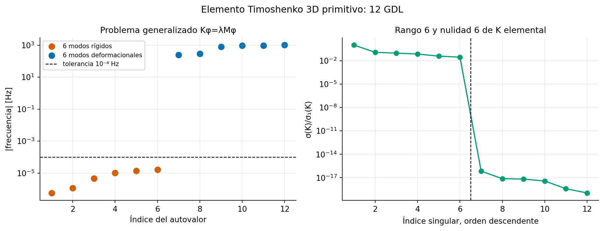

*Figura 4. A la izquierda se separan los seis ceros de los seis modos
deformacionales; a la derecha la SVD demuestra rango 6 y nulidad 6.*

### 4.3 Extensión a los elementos de la turbina y al modelo global

El mismo conteo rango--nulidad aplicado a los 133 elementos activos produjo
seis direcciones rígidas en cada uno, aun cuando cambian su longitud,
orientación y propiedades. La conclusión no depende del elemento sintético ni
de una dirección privilegiada.

Para el sistema global se construyó el campo rígido de todos los nodos, se lo
proyectó mediante las MPC y se comprobaron energía y compatibilidad. El modelo
libre–libre usado para este estudio incluye el constitutivo de tren de referencia
para que los maestros 129 y 130 formen un único sistema conectado.

| Caso | Coordenadas | Ceros | Máximo `|f_cero|` | Primera frecuencia flexible |
|---|---:|---:|---:|---:|
| Elemento primitivo | 12 | 6 | `1.596e-5 Hz` | `248.467 Hz` |
| Turbina conectada libre–libre | 810 | 6 | `9.662e-7 Hz` | `0.372022 Hz` |
| Misma turbina con base fija | 804 | 0 | 0 | `0.167768 Hz` |

En el caso libre–libre, el residuo rígido de energía fue `2.788e-19` y el de
compatibilidad con `Tc`, `3.317e-17`. El séptimo autovalor ya es flexible. Al
retirar los seis GDL de apoyo del nodo 1, ninguno de los 18 autovalores menores
evaluados es nulo. Esto demuestra simultáneamente conectividad global y ausencia
de mecanismos espurios dentro del rango examinado.

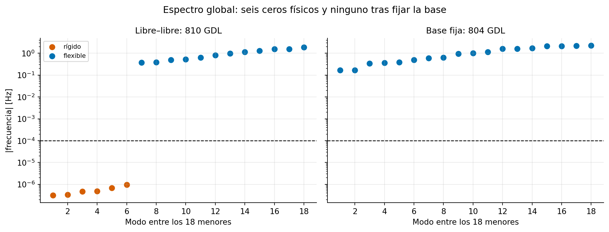

*Figura 5. Seis ceros en el ensamblaje libre–libre y cero mecanismos después
de empotrar la base.*

## 5. Restricciones exactas, grados de libertad y masas

### 5.1 MPC y apoyo

La relación cinemática entre las coordenadas nodales completas y las
independientes se escribe

\[
\bm q_{\mathrm{full}}=\bm T_c\,\bar{\bm q},
\qquad
\bar{\bm M}=\bm T_c^T\bm M_{\mathrm{full}}\bm T_c,
\qquad
\bar{\bm K}=\bm T_c^T\bm K_{\mathrm{full}}\bm T_c.
\]

El nodo 129 es maestro de la góndola y el 130 maestro del rotor. Las raíces 21,
57 y 93 son esclavas del nodo 130 con sus brazos geométricos. Cada raíz elimina
seis coordenadas dependientes: `828−18=810`. La base fija elimina después las
seis coordenadas del nodo 1: quedan 804 GDL de análisis.

$\bm T_c$ tiene tamaño $828\times810$, 846 entradas no nulas y rango
numérico 810. La condensación elimina solamente las 18 coordenadas esclavas y
preserva el brazo rígido entre el cubo y cada raíz. No se usa una rigidez de
penalización, de modo que no se introduce una frecuencia artificial asociada a
un resorte excesivamente rígido.

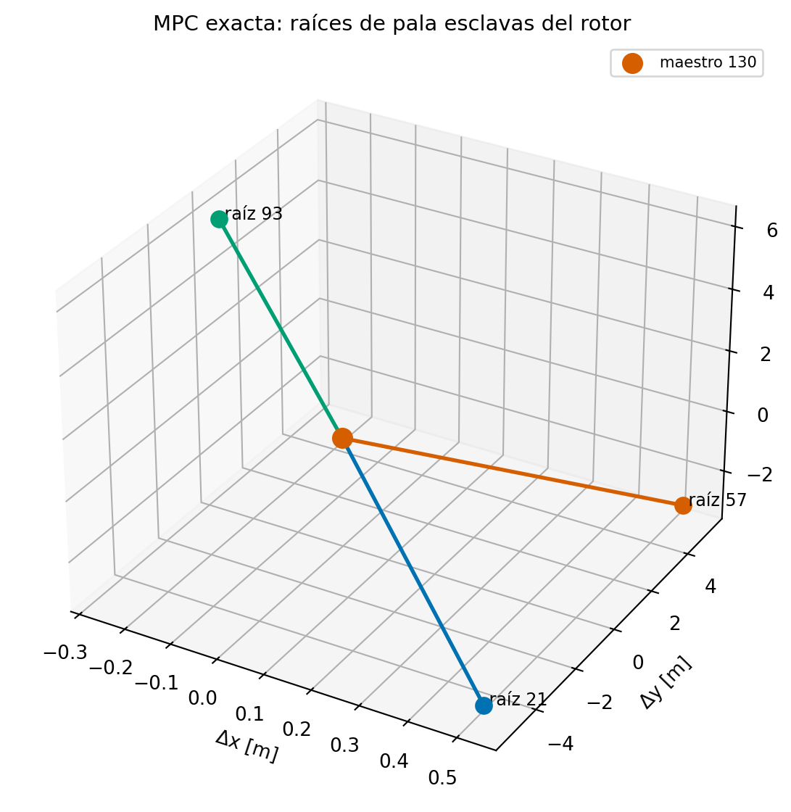

*Figura 10. Brazos desde el maestro del rotor hacia las tres raíces esclavas.*

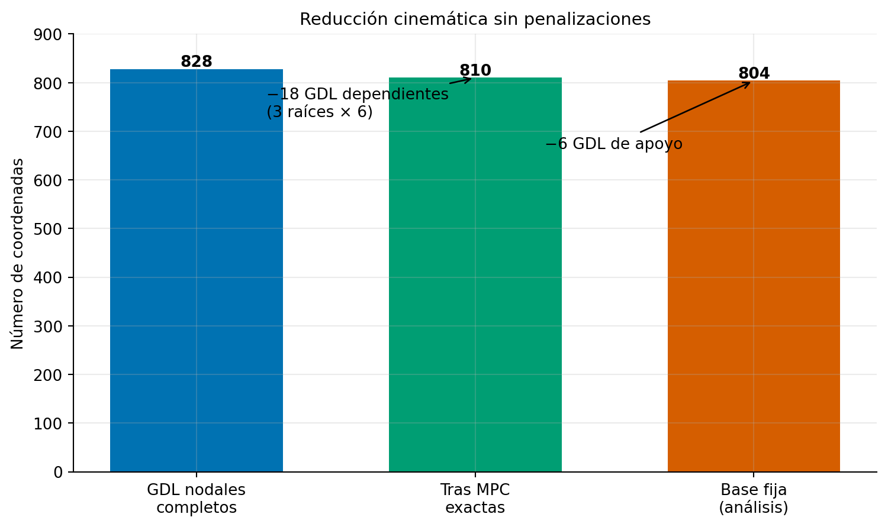

*Figura 11. Paso de 828 GDL nodales a 810 independientes y 804 de análisis.*

### 5.2 Masas distribuidas y cuerpos rígidos

| Contribución | Masa [kg] |
|---|---:|
| Torre | 859,784.72 |
| Pala 1 | 111,605.61 |
| Pala 2 | 111,608.51 |
| Pala 3 | 111,623.52 |
| Transiciones | 26,488.80 |
| Góndola | 1,184,500.00 |
| Cubo | 196,000.00 |
| **Total** | **2,601,611.15** |

La masa distribuida suma 1,221,111.15 kg y los cuerpos rígidos 1,380,500 kg.
El CG global calculado es `[0.460663, 2.251e-6, 113.886566] m`. La orientación
de la góndola conserva el tensor completo, incluido `Jxz=1.551199e6 kg·m²`.
Los offsets `rCG` se mantienen en cero porque el legado no proporciona un dato
disponible; esta colocalización es una hipótesis visible.

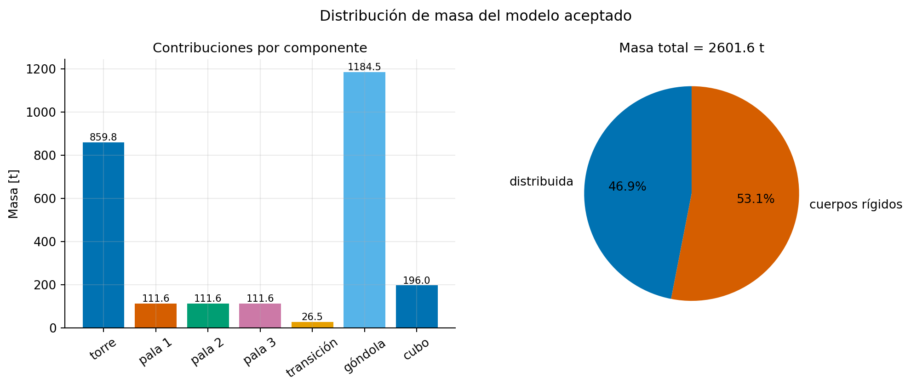

*Figura 12. La góndola domina la masa concentrada; la masa flexible sigue siendo
una fracción importante y se integra elemento a elemento.*

### 5.3 Sensibilidad a la formulación de masa

La matriz consistente es la opción de producción. HRZ se implementó solo como
comparación. Ambas conservan la masa total, pero HRZ cambia levemente el CG y
las frecuencias: en ocho modos de torre la diferencia máxima fue 1.0738% y el
MAC mínimo después de asociar ramas fue 0.911563. Por ello, las frecuencias
publicadas en el resto del informe corresponden a la masa consistente; HRZ se
muestra únicamente como sensibilidad a la redistribución de masa.

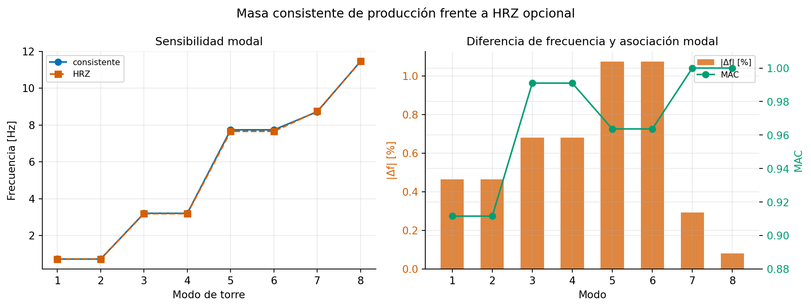

*Figura 13. HRZ conserva la masa traslacional, pero altera la distribución y
por tanto el espectro. La diferencia cuantifica sensibilidad, no incertidumbre
física completa.*

## 6. Convergencia espacial y resultados de subsistemas

### 6.1 Caso analítico de viga uniforme

El caso usa una viga uniforme de 12 m, integración selectiva y referencias
analíticas para desplazamiento de punta y frecuencias de flexión. A 64
elementos se obtuvo:

| Magnitud | Resultado | Error relativo | Criterio esperado |
|---|---:|---:|---:|
| Desplazamiento de punta | `9.59944e-6 m` | `6.103e-5` | `1e-3` |
| Primera frecuencia | `6.02046 Hz` | `3.643e-5` | `1e-3` |
| Segunda frecuencia | `37.75024 Hz` | `5.838e-4` | `1e-3` |

Con un único elemento, la segunda frecuencia es `3.248743e6 Hz`. Ese valor no
es una frecuencia física de la viga: la discretización de un elemento no puede
representar la segunda forma de flexión y el autovector disponible se vuelve
dominantemente cortante. Su descenso monótono hacia la referencia al refinar es
precisamente la evidencia relevante. El primer modo y el desplazamiento también
convergen sin mostrar bloqueo por cortante en el régimen probado.

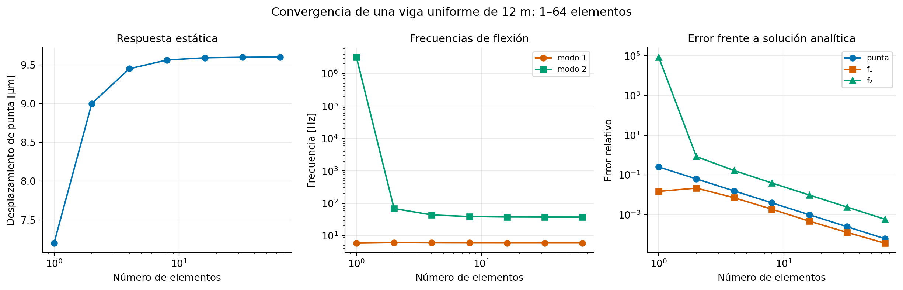

*Figura 7. Desplazamiento, frecuencias y errores relativos frente a las
soluciones analíticas para 1--64 elementos.*

### 6.2 Voladizos aislados

La torre y cada pala se extrajeron del modelo y se empotraron en su raíz. Así
se obtienen frecuencias propias de cada componente antes de ensamblar la
turbina:

| Subsistema | Longitud [m] | Masa [kg] | Primera frecuencia [Hz] |
|---|---:|---:|---:|
| Torre | 135.0000 | 859,784.72 | 0.7196683 |
| Pala 1 | 100.0820 | 111,605.61 | 0.4194612 |
| Pala 2 | 100.0821 | 111,608.51 | 0.4194880 |
| Pala 3 | 100.0899 | 111,623.52 | 0.4194551 |

La dispersión relativa máxima entre frecuencias homólogas de las tres palas es
`1.674e-4` (0.01674%), frente a un criterio esperado de `1e-3` (0.1%). La
pequeña diferencia es coherente con las diferencias heredadas de geometría y
masa; no indica una separación modal significativa entre palas.

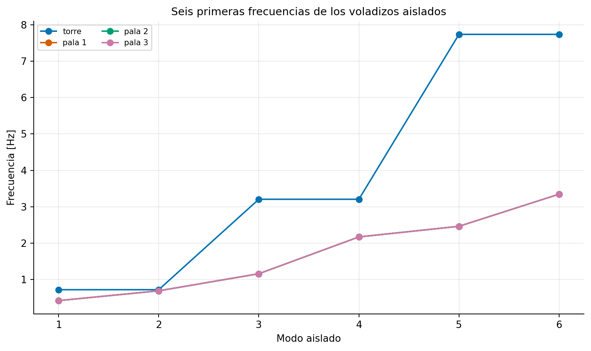

*Figura 8. Seis primeras frecuencias de torre y palas como voladizos aislados.*

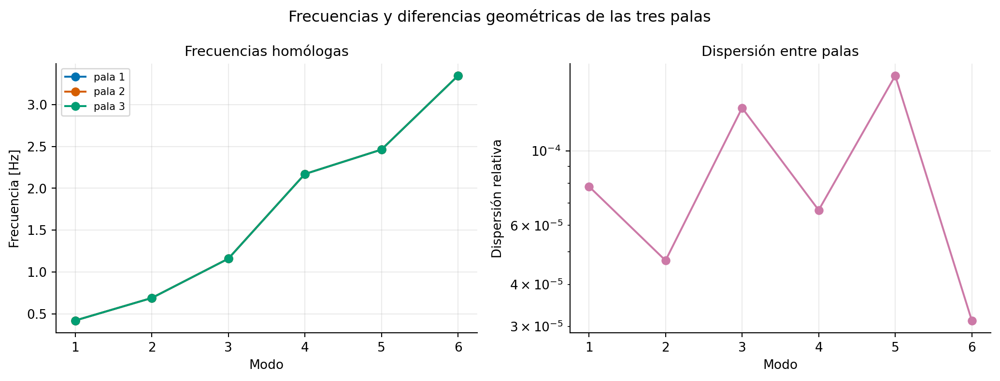

*Figura 9. Coincidencia de frecuencias homólogas y dispersión relativa por modo.*

Estas frecuencias no son las de la turbina completa: no incluyen masas rígidas,
tren, gravedad, giro ni acoplamiento torre–rotor.

## 7. Equilibrio estático, gravedad y centrifugación

El equilibrio usa una descripción corrotacional. En cada iteración se actualiza
el marco del elemento, se separa el movimiento rígido y se evalúa la energía
Timoshenko sobre la deformación local. Para una velocidad prescrita $\Omega$,
la ecuación no lineal es

\[
\bm r(\bm q;\Omega)
=\bm f_{\mathrm{int}}(\bm q)
-\bm f_g
-\bm f_c(\bm q;\Omega)
-\bm f_a(\bm q,\dot{\bm q})
=\bm 0 .
\]

La actualización de Newton resuelve

\[
\bm K_T(\bm q_k;\Omega)\,\Delta\bm q_k=-\bm r_k,
\qquad
\bm q_{k+1}=\bm q_k+\eta_k\Delta\bm q_k,
\]

donde $0<\eta_k\leq1$ procede de la búsqueda lineal. La continuación
$0\rightarrow6\rightarrow12$ RPM reutiliza el estado anterior y evita aplicar
de una vez toda la carga centrífuga.

| RPM | Iteraciones | Residuo relativo | Criterio esperado | $u_{\max}$ [m] | $\lVert\bm f_c\rVert$ [MN] |
|---:|---:|---:|---:|---:|---:|
| 0 | 5 | `8.984e-9` | $\leq10^{-8}$ | 1.39153 | 0 |
| 6 | 5 | `3.641e-9` | $\leq10^{-8}$ | 1.40993 | 0.5466 |
| 12 | 6 | `6.586e-9` | $\leq10^{-8}$ | 1.46241 | 2.1867 |

La fuerza centrífuga cumple $\bm f_c\propto\Omega^2$: al duplicar la velocidad
de 6 a 12 RPM su norma se cuadruplica. La norma de la carga gravitacional es
$1.195738\times10^7$ N. El axial de compresión en la base de la torre cambia de
aproximadamente $-25.190$ MN a $-25.305$ MN entre 0 y 12 RPM, mientras el
máximo axial de tracción en palas crece de 0.573 MN a 7.565 MN. El incremento
de $u_{\max}$, de 1.3915 m a 1.4624 m, refleja la combinación entre gravedad,
rigidez geométrica y tracción centrífuga.

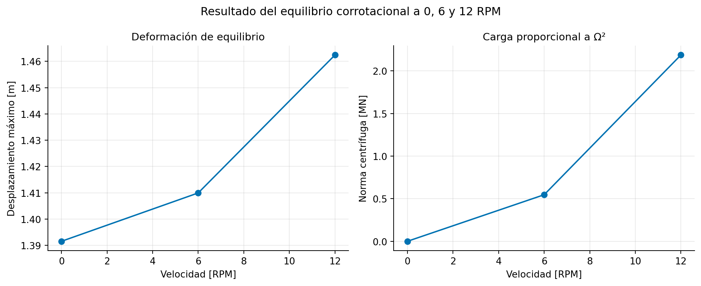

*Figura 14. Desplazamiento máximo de equilibrio y norma de la carga centrífuga
para las tres velocidades prescritas.*

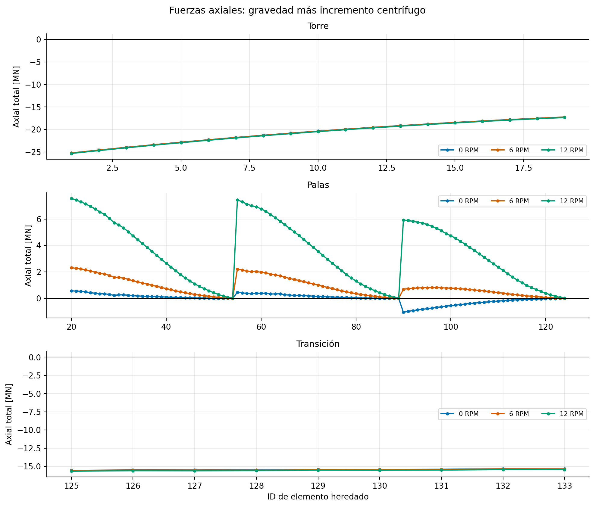

*Figura 15. Axiales totales por torre, palas y transiciones para 0, 6 y 12 RPM.*

En los resultados actuales la contribución centrífuga a la tangente está
incluida en $\bm K_g$; por esa convención $\bm K_\Omega=\bm0$ y no se suma una
segunda vez. La velocidad del rotor es prescrita: no se obtiene de un balance
entre torque aerodinámico y generador.

## 8. Operadores dinámicos, amortiguamiento y aerodinámica

### 8.1 Giroscopía

La giroscopía de cada pala se integra con la cinemática Timoshenko y el cubo
aporta su matriz espacial. Torre, góndola y cimentación no rotan. El operador
entra en la parte proporcional a velocidad de la ecuación linealizada,

\[
\bm M\ddot{\bm q}+(\bm C+\bm G)\dot{\bm q}+\bm K\bm q=\bm f(t),
\qquad
\bm G^T=-\bm G,
\qquad
\bm v^T\bm G\bm v=0.
\]

Así, $\bm G$ modifica las frecuencias y acopla direcciones, pero no disipa
energía. A 12 RPM:

- `||G_distribuida||_F = 1.718598e5`;
- `||G_cubo||_F = 5.063984e6`;
- normas por pala: 99,209.622; 99,219.879; 99,240.373;
- dispersión relativa entre palas: `3.0992e-4`.

La contribución del cubo es aproximadamente 29.5 veces la norma distribuida de
las palas. El crecimiento lineal con $\Omega$ explica por qué el desdoblamiento
modal aparece progresivamente en el Campbell, aun sin aplicar viento.

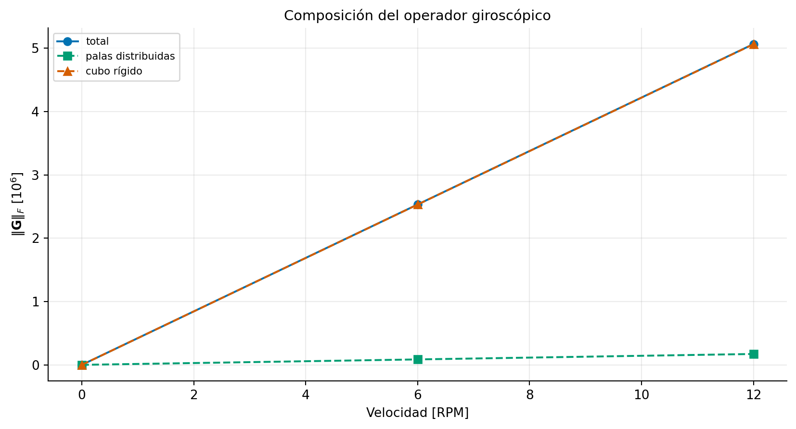

*Figura 16. Crecimiento lineal y composición de la norma del operador
giroscópico; el cubo rígido domina sobre la contribución distribuida.*

### 8.2 Amortiguamiento Rayleigh

El modelo adopta 1% de amortiguamiento en 0.2 y 2.0 Hz y obtiene

\[
\bm C_R=\alpha\bm M+\beta\bm K_e,
\qquad
\zeta(\omega)=\frac12\left(\frac{\alpha}{\omega}+\beta\omega\right),
\]

con $\alpha=0.02284794657\;\mathrm{s}^{-1}$ y
$\beta=0.001446863119\;\mathrm{s}$. El valor esperado en ambos puntos de
anclaje es $\zeta=0.01$ y el error absoluto calculado es
$1.735\times10^{-18}$. La rigidez de referencia es $\bm K_e$, no la tangente
operativa completa. El 1% es un supuesto de cálculo y no procede de una
identificación modal experimental.

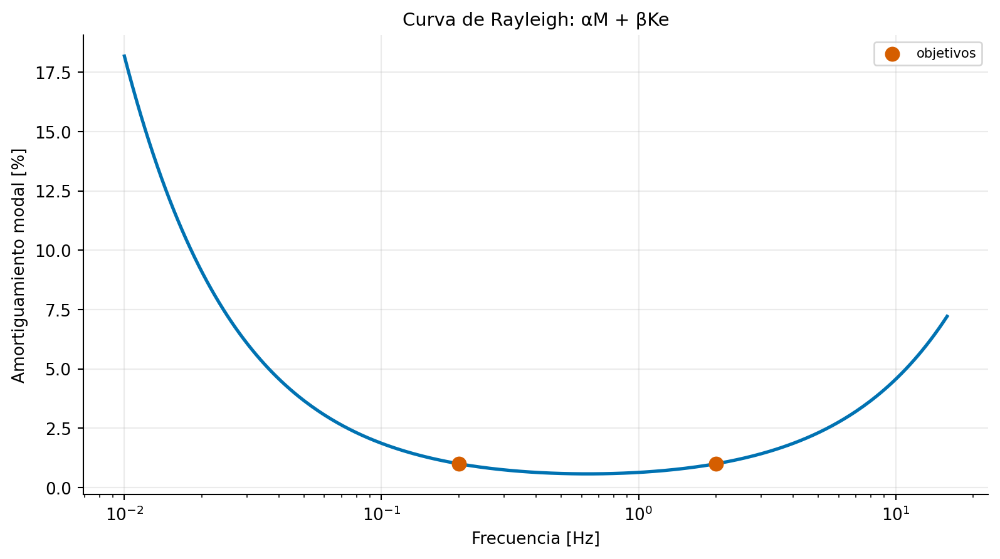

*Figura 17. La curva pasa por los dos valores adoptados de 1%, pero fuera de ellos el
amortiguamiento es una extrapolación del modelo de Rayleigh.*

### 8.3 Inserción de cargas de viento y alcance actual

El solver admite una fuerza aerodinámica generalizada no lineal
$\bm f_a(\bm q,\dot{\bm q},t)$, evaluada en el equilibrio junto con gravedad y
centrifugación. Al linealizar alrededor del estado operativo
$(\bm q_0,\dot{\bm q}_0)$ se definen

\[
\bm K_a=-\left.\frac{\partial\bm f_a}{\partial\bm q}\right|_0,
\qquad
\bm C_a=-\left.\frac{\partial\bm f_a}{\partial\dot{\bm q}}\right|_0,
\]

de forma que ambos operadores pasan al lado izquierdo:

\[
\bm D=\bm C_s+\bm C_a+\bm G,
\qquad
\bm K=\bm K_e+\bm K_g+\bm K_\Omega+\bm K_a.
\]

Si el modelo externo suministra tangentes analíticas se usan directamente. En
caso contrario, cada columna se calcula por diferencias centrales,

\[
(\bm K_a)_{:,j}\simeq-
\frac{\bm f_a(\bm q_0+h_j\bm e_j,\dot{\bm q}_0)
-\bm f_a(\bm q_0-h_j\bm e_j,\dot{\bm q}_0)}{2h_j},
\]

con una expresión análoga para $\bm C_a$ perturbando la velocidad. La razón de
errores entre pasos $h$ y $h/2$ fue 4.000, igual al valor esperado para una
diferencia central de segundo orden; los errores relativos de las tangentes de
referencia fueron $3.583\times10^{-8}$ y $3.397\times10^{-8}$.

Sin embargo, **en todos los resultados físicos de este informe** se tiene
$\bm f_a=\bm0$, $\bm K_a=\bm0$ y $\bm C_a=\bm0$ porque no se proporcionaron
coeficientes aerodinámicos. No hay velocidad o dirección de viento, densidad
del aire, perfil vertical, turbulencia, ráfaga, polares, BEM, control de pitch o
yaw, empuje ni torque aerodinámico. Por tanto, el equilibrio, Campbell y sismo
presentados incluyen giro prescrito, gravedad y centrifugación, pero **no una
carga de viento** ni combinación sismo--viento.

## 9. MBC, problema cuadrático y Campbell

### 9.1 Transformación multiblade físicamente homóloga

Antes de mezclar armónicos, cada pala se expresa en marcos locales homólogos.
Si $\bm z$ contiene coordenadas colectivas, coseno y seno, la transformación
dependiente del azimut es

\[
\bm q=\bm P(t)\bm z,
\qquad
\bm P=\bm H\bm T_B.
\]

Al derivar $\bm q$ aparecen $\dot{\bm P}$ y $\ddot{\bm P}$; por eso los
operadores transformados no son una simple congruencia:

\[
\bar{\bm M}=\bm P^T\bm M\bm P,
\]

\[
\bar{\bm D}=\bm P^T
(\bm D\bm P+2\bm M\dot{\bm P}),
\]

\[
\bar{\bm K}=\bm P^T
(\bm K\bm P+\bm D\dot{\bm P}+\bm M\ddot{\bm P}).
\]

Las métricas se comparan con la precisión esperada de las operaciones y de las
diferencias finitas: ortogonalidad de $\bm H$, $1.377\times10^{-16}$ frente a
$10^{-12}$; identidad $\bm P^{-1}\bm P$, $7.160\times10^{-16}$ frente a
$10^{-12}$; derivada primera, $4.811\times10^{-11}$ frente a $10^{-8}$;
derivada segunda, $2.101\times10^{-6}$ frente a $2\times10^{-5}$; y
reconstrucción, $2.781\times10^{-16}$ frente a $10^{-12}$. Estos errores son
mucho menores que las variaciones modales interpretadas en el Campbell.

### 9.2 QEP y equivalencia a velocidad cero

En cada velocidad se linealiza alrededor del equilibrio y se resuelve el
problema cuadrático de autovalores (QEP)

\[
\bm Q(s)\bm\phi
=\left(s^2\bm M+s\bm D+\bm K\right)\bm\phi=\bm0,
\qquad s=\sigma+\mathrm i\omega_d .
\]

No se forma $\bm M^{-1}$. El polinomio se convierte en el lápiz generalizado

\[
\begin{bmatrix}
\bm0&\bm I\\
-\bm K&-\bm D
\end{bmatrix}
\begin{bmatrix}\bm\phi\\s\bm\phi\end{bmatrix}
=s
\begin{bmatrix}
\bm I&\bm0\\
\bm0&\bm M
\end{bmatrix}
\begin{bmatrix}\bm\phi\\s\bm\phi\end{bmatrix}.
\]

Los 804 GDL producen un lápiz de orden 1608. El solucionador disperso extrae
28 raíces próximas al origen; se reporta un representante con parte imaginaria
positiva de cada uno de los 12 pares físicos y cuatro raíces sirven de margen
de selección. Para cada raíz,

\[
f_d=\frac{|\operatorname{Im}s|}{2\pi},
\qquad
f_n=\frac{|s|}{2\pi},
\qquad
\zeta=-\frac{\operatorname{Re}s}{|s|}.
\]

La distancia normalizada del par calculado a la ecuación original es

\[
\rho_i=
\frac{\|\bm Q(s_i)\bm\phi_i\|_2}
{\left(|s_i|^2\|\bm M\|_2+|s_i|\|\bm D\|_2+
\|\bm K\|_2\right)\|\bm\phi_i\|_2}.
\]

A 0 RPM, el problema conservativo y la formulación MBC coinciden con error
relativo $3.452\times10^{-13}$; el valor esperado es menor que $10^{-6}$.
Al anular el amortiguamiento, el QEP recupera las frecuencias conservativas con
error $6.112\times10^{-13}$. El máximo $\rho_i$ fue
$2.505\times10^{-16}$ frente al criterio $10^{-8}$; el residuo adjunto fue
$7.494\times10^{-14}$, el error de pares conjugados fue cero y la parte fuera
de diagonal biortogonal fue $7.602\times10^{-11}$ frente a $10^{-6}$.

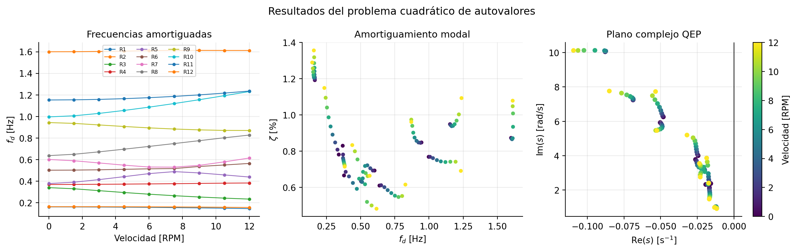

*Figura 21. Frecuencias amortiguadas, razones de amortiguamiento y raíces del
QEP en el plano complejo. La ubicación de cada raíz determina $f_d$ y
$\zeta$.*

La máxima parte real de las raíces extraídas fue
$-1.181\times10^{-2}\;\mathrm{s}^{-1}$, correspondiente a la rama 1 a 12 RPM.
Por tanto, ninguna de las 12 ramas calculadas crece exponencialmente. Esto no
certifica la estabilidad del espectro completo, pues solo se extrajeron 28 de
las 1608 raíces del lápiz.

### 9.3 Diagrama Campbell y seguimiento

El Campbell usa nueve velocidades entre 0 y 12 RPM y sigue 12 ramas. Dos modos
en velocidades consecutivas se asocian mediante

\[
\operatorname{MAC}_{ij}
=\frac{|\bm\phi_i^H\bm M\bm\phi_j|^2}
{(\bm\phi_i^H\bm M\bm\phi_i)
(\bm\phi_j^H\bm M\bm\phi_j)}.
\]

Fuera de dobletes casi degenerados, el MAC mínimo fue 0.8289 frente al valor
esperado 0.80. En los dobletes se comparan subespacios mediante ángulos
principales; el mínimo fue 0.9693 frente a 0.95. Esta distinción evita
interpretar como pérdida de continuidad una rotación arbitraria de la base
dentro del mismo subespacio modal.

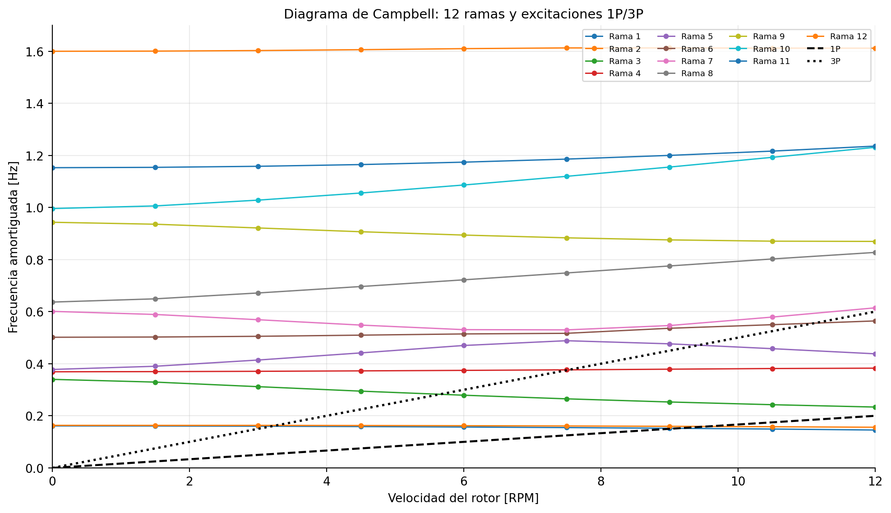

*Figura 19. Doce ramas sobre nueve velocidades; las rectas 1P y 3P representan
las frecuencias de paso del rotor y de tres palas.*

Las frecuencias de excitación cinemática son

\[
f_{1P}=\frac{\mathrm{RPM}}{60},
\qquad
f_{3P}=3\,\frac{\mathrm{RPM}}{60}.
\]

A 0 RPM, las 12 ramas cubren de 0.161234 a 1.599818 Hz. A 12 RPM las
frecuencias amortiguadas son:

\[
\begin{aligned}
\bm f_d(12\ \mathrm{RPM})={}&
\{0.145471,\ 0.156113,\ 0.233688,\ 0.382958,\ 0.438185,\ 0.564397,\\
&0.614622,\ 0.827431,\ 0.869749,\ 1.230962,\ 1.235641,\ 1.611690\}
\ \mathrm{Hz}.
\end{aligned}
\]

La razón de amortiguamiento calculada en el barrido varía entre 0.483% y
1.357%. La interpolación lineal identifica coincidencias 1P con las ramas 1 y
2 a 9.119 y 9.549 RPM, y coincidencias 3P con las ramas 1--6 a 3.200, 3.264,
5.655, 7.532, 9.425 y 11.118 RPM. Son **candidatos de resonancia**, no
resonancias críticas: faltan las amplitudes de excitación, el viento, el
control y un criterio de margen.

El Campbell está congelado en un azimut de referencia. No es un análisis de
Floquet ni reproduce por sí solo la periodicidad completa de una turbina en
rotación.

### 9.4 Formas modales recuperadas

Las seis formas siguientes son las primeras ramas exportadas del caso integral.
La deformación está amplificada para hacer visible el patrón; no representa una
amplitud física.


*Figura 34. Forma modal 1 a 0 RPM: primera rama del tren de potencia,
0.161234 Hz. La amplitud se normaliza y amplifica solo para visualización.*

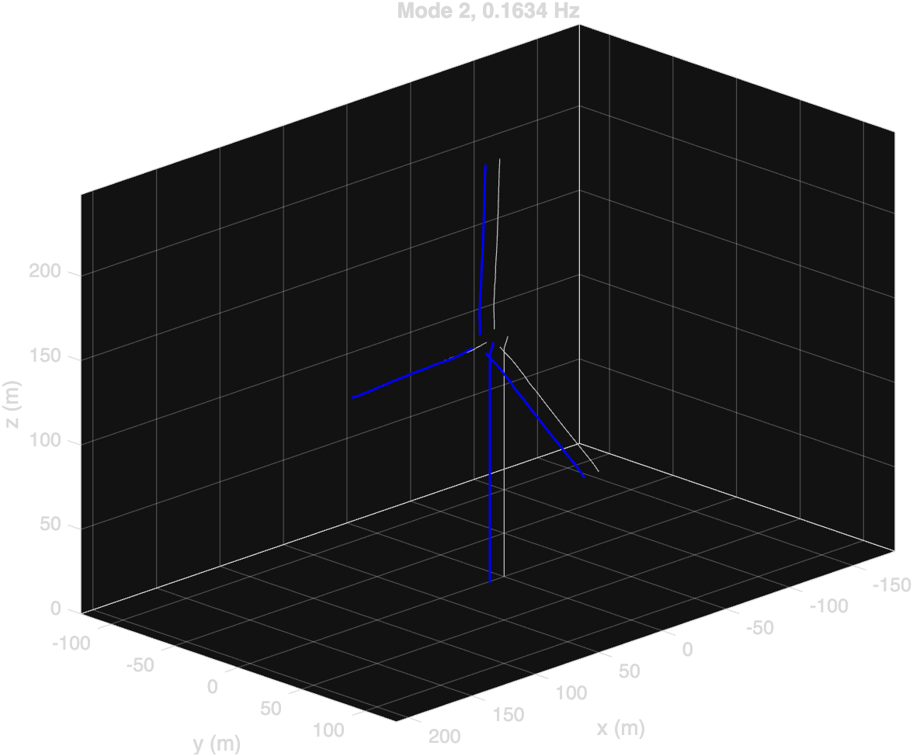

*Figura 35. Forma modal 2 a 0 RPM: segunda rama del tren de potencia,
0.163378 Hz. La amplitud mostrada no es una respuesta física.*

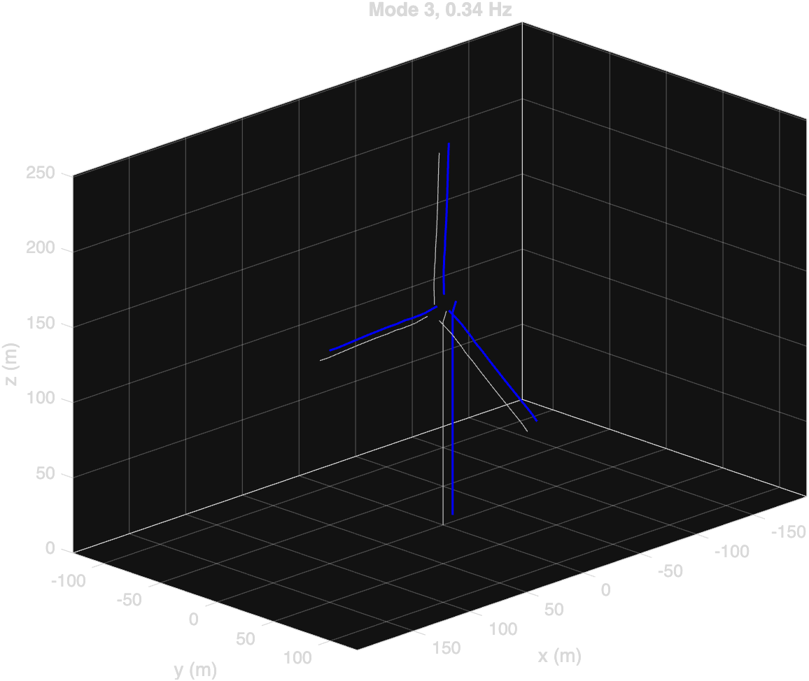

*Figura 36. Forma modal 3 a 0 RPM: rama dominada por palas, 0.340023 Hz.*

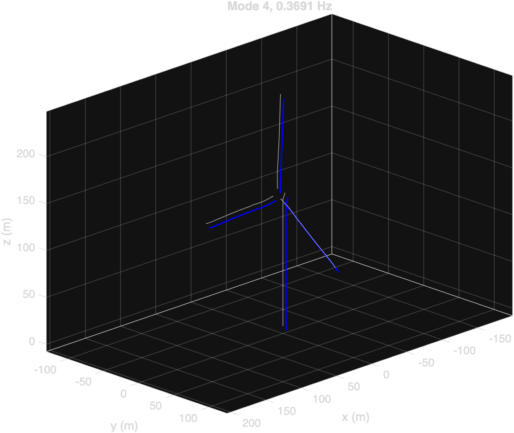

*Figura 37. Forma modal 4 a 0 RPM: rama dominada por palas, 0.369133 Hz.*


*Figura 38. Forma modal 5 a 0 RPM: rama dominada por palas, 0.378025 Hz.*

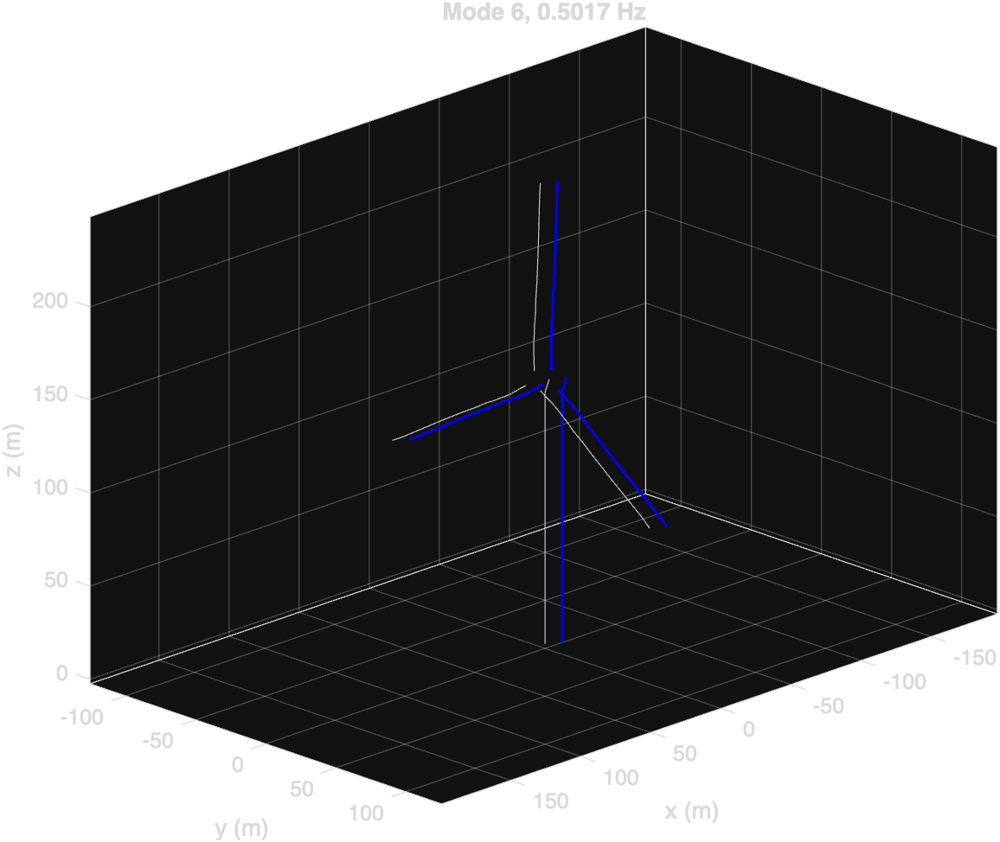

*Figura 39. Forma modal 6 a 0 RPM: rama dominada por palas, 0.501694 Hz.*

## 10. Respuesta sísmica con Newmark

### 10.1 Ecuación, entrada y proyección

La coordenada $\bm q(t)$ describe movimiento **relativo al terreno**. Los
operadores físicos se congelan en el equilibrio de 0 o 12 RPM y se resuelve

\[
\bm M_r\ddot{\bm q}
+\bm D_r\dot{\bm q}
+\bm K_r\bm q
=-\bm M_r\bm\Gamma_{\mathrm{eff}}\bm a_g(t)
+\bm f_{\mathrm{other}}(t),
\]

donde

\[
\bm M_r=\bm T_c^T\bm M_{\mathrm{full}}\bm T_c,
\qquad
\bm M_r\bm\Gamma_{\mathrm{eff}}
=\bm T_c^T\bm M_{\mathrm{full}}\bm R_{\mathrm{full}}.
\]

$\bm R_{\mathrm{full}}$ coloca una unidad en los GDL traslacionales de todos
los nodos para cada dirección excitada. Al proyectar con masa aparece
$\bm\Gamma_{\mathrm{eff}}$, que genera la fuerza inercial correcta incluso
cuando las MPC ligan raíces y cubo. La influencia cinemática
$\bm\Gamma_{\mathrm{kin}}$ se usa únicamente para reconstruir movimiento
absoluto compatible:

\[
\bm u_{\mathrm{abs}}
=\bm T_c\bm q+\bm R_{\mathrm{full}}\bm u_g,
\quad
\bm v_{\mathrm{abs}}
=\bm T_c\dot{\bm q}+\bm R_{\mathrm{full}}\bm v_g,
\quad
\bm a_{\mathrm{abs}}
=\bm T_c\ddot{\bm q}+\bm R_{\mathrm{full}}\bm a_g.
\]

El lector de acelerogramas acepta arreglos, tablas, estructuras o archivos;
convierte las unidades a SI, interpola al paso solicitado y, si faltan
$\bm v_g$ o $\bm u_g$, las integra. También permite escala y corrección de línea
base. Para estos resultados se suministraron directamente desplazamiento,
velocidad y aceleración analíticos, con escala uno y sin corrección de línea
base.

El movimiento sintético se aplica en las direcciones globales $x$ y $y$:

\[
u_{gx}(t)=0.003\sin^3(2\pi\,0.65\,t),\qquad
u_{gy}(t)=0.0018\sin^3(2\pi\,0.90\,t),
\qquad 0\leq t\leq1\ \mathrm{s},
\]

con $\bm v_g=\dot{\bm u}_g$ y $\bm a_g=\ddot{\bm u}_g$. Los máximos de
desplazamiento son 3.0 y 1.8 mm; los de velocidad, aproximadamente 0.01415 y
0.01175 m/s; y las PGA, 0.1501 y 0.1727 m/s$^2$ (0.0153 y 0.0176 g). El estado
inicial es nulo, pero el registro de un segundo no termina con todas sus
derivadas en cero ni incluye una cola de vibración libre. Por ello sirve para
comparar la respuesta de los dos puntos operativos, no como acelerograma de
diseño.

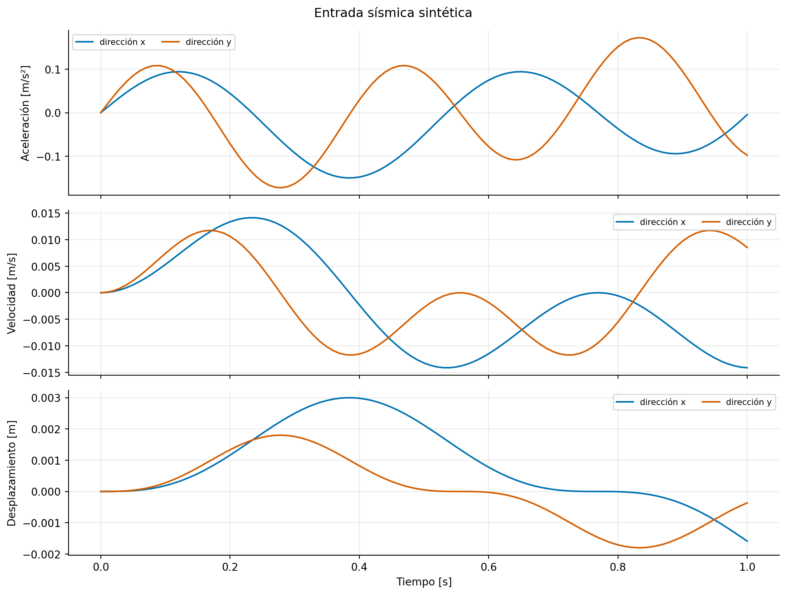

*Figura 23. Entrada sísmica sintética en las direcciones globales x e y:
aceleración, velocidad y desplazamiento del terreno en SI.*

### 10.2 Integración y convergencia temporal

Se utilizó Newmark de aceleración promedio constante,
$\beta=1/4$ y $\gamma=1/2$. Para un paso $\Delta t$ se definen

\[
a_0=\frac{1}{\beta\Delta t^2},
\qquad
a_1=\frac{\gamma}{\beta\Delta t},
\qquad
\bm K_{\mathrm{eff}}
=\bm K_r+a_0\bm M_r+a_1\bm D_r .
\]

En cada instante se construye una carga efectiva con la fuerza sísmica y los
estados del paso anterior, se factoriza $\bm K_{\mathrm{eff}}$ y se obtiene
$\bm q_{n+1}$ mediante solución lineal, sin invertir matrices. Luego,

\[
\ddot{\bm q}_{n+1}
=a_0(\bm q_{n+1}-\bm q_n)
-\frac{1}{\beta\Delta t}\dot{\bm q}_n
-\left(\frac{1}{2\beta}-1\right)\ddot{\bm q}_n,
\]

\[
\dot{\bm q}_{n+1}
=\dot{\bm q}_n+\Delta t
\left[(1-\gamma)\ddot{\bm q}_n+\gamma\ddot{\bm q}_{n+1}\right].
\]

El esquema es de segundo orden para el problema lineal. Un oscilador de un GDL
dio error relativo fino $2.1861\times10^{-6}$ frente al valor esperado
$10^{-4}$ y orden 1.9975 frente al esperado mínimo 1.9. En el modelo completo
se usaron $\Delta t=\{0.02,0.01,0.005,0.0025,0.00125\}$ s: el orden observado
fue 2.0017 frente al mínimo 1.8; la diferencia relativa entre las dos
soluciones más finas fue $3.0719\times10^{-4}$ frente a $10^{-3}$, y la
diferencia de máximos fue $2.3236\times10^{-4}$. La respuesta publicada usa
$\Delta t=0.01$ s.

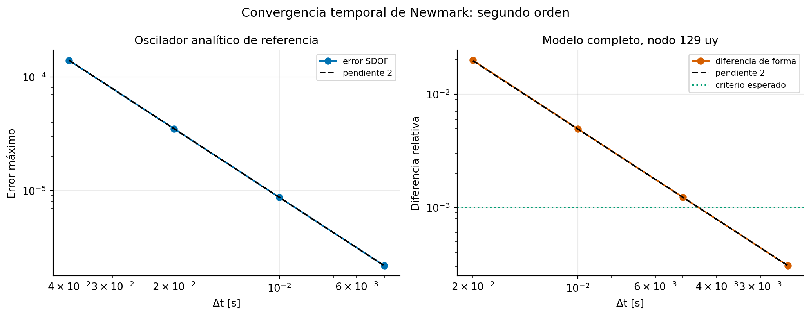

*Figura 26. Convergencia temporal: la pendiente próxima a dos confirma el orden
esperado de Newmark en el oscilador de referencia y en el canal nodo 129--uy.*

### 10.3 Respuesta, reacciones y fuerzas internas

Se observan el nodo 1 en la base, el nodo 129 en la góndola, el nodo 130 en el
rotor y los nodos 56, 92 y 128 en las puntas de las tres palas. Los ejes
$x,y,z$ son los globales mostrados en la geometría. Antes de interpretar las
amplitudes, las métricas numéricas se comparan con sus valores esperados:

| Métrica | Resultado | Valor esperado | Interpretación |
|---|---:|---:|---|
| Proyección de masa del sismo | `3.8771e-17` | $\leq10^{-12}$ | la fuerza reducida representa el campo completo |
| Residuo dinámico máximo | `6.1205e-13` | $\leq10^{-9}$ | cierre de la ecuación semidiscreta |
| Balance energético relativo | `1.0584e-12` | $\leq10^{-6}$ | trabajo de entrada y energía del sistema |
| Cinemática absoluta | `4.4345e-17` | $\leq10^{-12}$ | suma coherente de respuesta relativa y terreno |
| Equilibrio proyectado de restricciones | `6.2262e-13` | $\leq10^{-9}$ | compatibilidad entre fuerzas completas y reducidas |

Estas tolerancias califican el error del procedimiento numérico; no son límites
de servicio ni de resistencia de la turbina.

En el canal $u_y$ de la punta de pala del nodo 128 se obtuvo un desplazamiento
relativo máximo absoluto de 15.167 mm a 0 RPM y 12.849 mm a 12 RPM; las
aceleraciones absolutas máximas correspondientes fueron 1.816 y 1.687 m/s².
Esto equivale a reducciones de 15.28% y 7.10% en ese canal. El máximo de
aceleración entre todos los nodos observados del caso a 12 RPM fue 1.739
m/s², en el nodo 92 y dirección $x$. El cambio muestra que la rotación y el
estado de equilibrio modifican la respuesta del caso sintético, pero no
constituye por sí solo un factor de diseño.

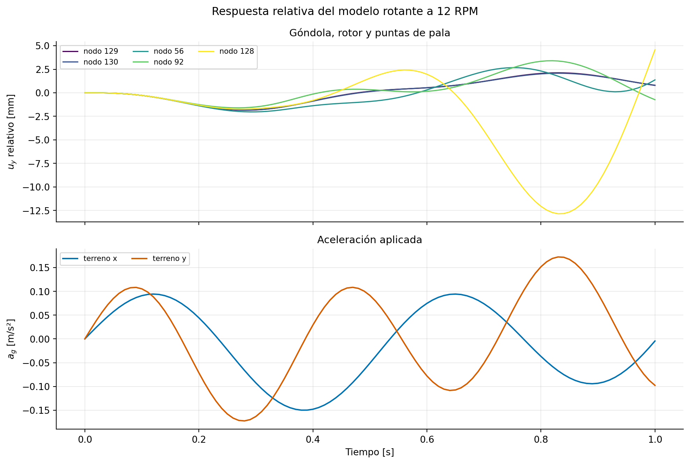

*Figura 24. Respuesta relativa de góndola, rotor y puntas a 12 RPM, junto con la
aceleración de terreno aplicada en x e y.*

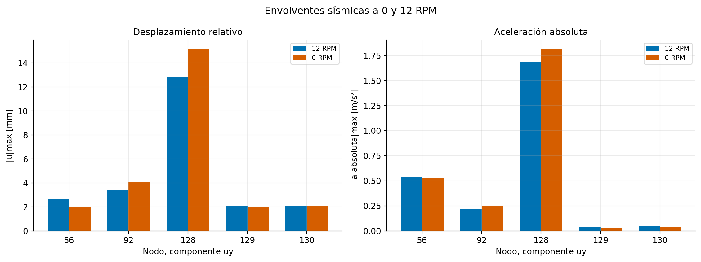

*Figura 25. Envolventes uy y aceleración absoluta de nodos instrumentados.*

En el caso rotante de 12 RPM, las reacciones máximas del nodo 1 fueron 91.035,
77.183 y 53.671 kN en $F_x,F_y,F_z$, y 3.520, 4.314 y 0.0418 MN·m en
$M_x,M_y,M_z$. Son incrementos debidos al movimiento sísmico alrededor del
equilibrio operativo y no incluyen una comparación con capacidad resistente.

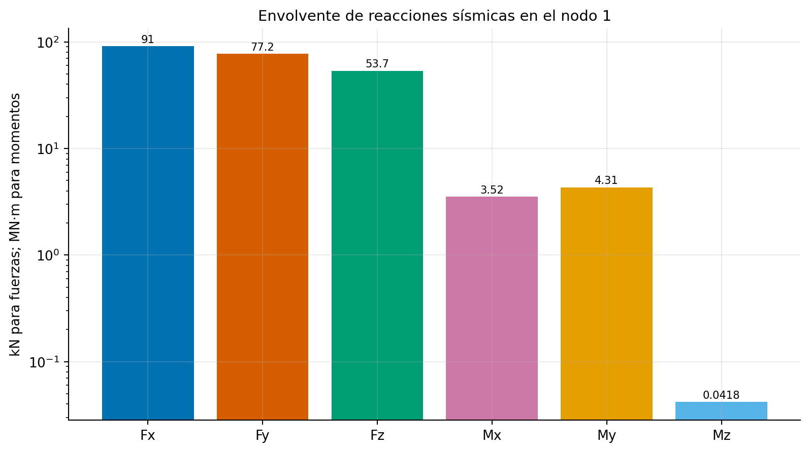

*Figura 27. Reacciones máximas de base del caso rotante a 12 RPM; escala
logarítmica común para las tres fuerzas y los tres momentos.*

Se recuperaron fuerzas de extremo locales y globales para los 133 elementos.
En el caso de 12 RPM, los máximos fueron: axial 71.706 kN en la pala, elemento
87; cortantes $V_2=75.892$ kN y $V_3=87.317$ kN en la torre, elemento 1;
torsión 92.146 kN·m en la transición, elemento 126; y momentos
$M_2=3.992$ MN·m y $M_3=3.394$ MN·m en la torre, elemento 1.

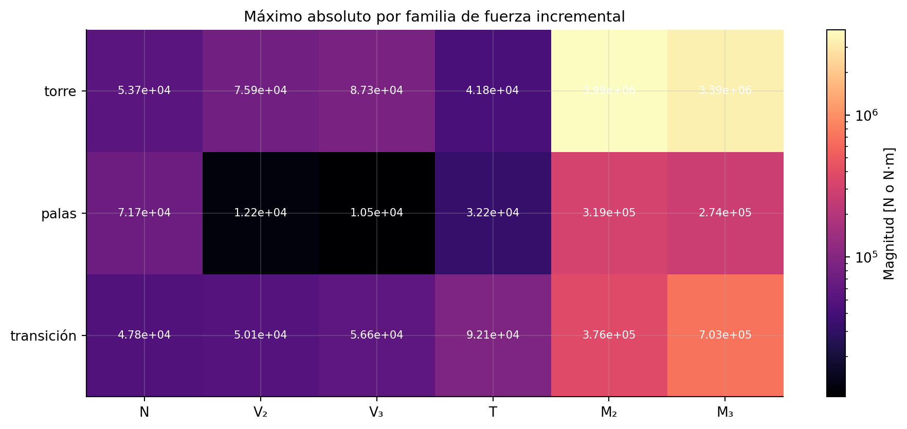

*Figura 28. Envolventes del caso rotante a 12 RPM: axial, cortantes, torsión y
momentos por familia de elemento. Son incrementos linealizados y no incluyen de
nuevo la precarga estática.*

## 12. Qué puede concluirse y qué no

### 12.1 Conclusiones demostradas

1. La conversión produce una turbina de 138 nodos y 133 elementos flexibles:
   19 de torre, 105 de palas y 9 transiciones. Las MPC y el apoyo reducen
   $828\rightarrow810\rightarrow804$ GDL sin introducir resortes de
   penalización.
2. El elemento Timoshenko de 12 GDL tiene rango de rigidez 6 y nulidad 6. Sus
   seis primeros valores corresponden a tres traslaciones y tres rotaciones de
   cuerpo rígido; los seis restantes son modos deformacionales con frecuencias
   positivas entre 248.467 y 1010.603 Hz para el caso primitivo.
3. El modelo completo conectado conserva exactamente seis modos rígidos cuando
   está libre y ninguno cuando se fija la base. Por tanto, la primera
   frecuencia flexible no está contaminada por mecanismos espurios.
4. En la viga uniforme con 64 elementos, los errores relativos de
   desplazamiento, primera frecuencia y segunda frecuencia son
   $6.103\times10^{-5}$, $3.643\times10^{-5}$ y
   $5.838\times10^{-4}$, respectivamente, todos menores que $10^{-3}$.
5. La masa total es 2,601,611.15 kg. La masa consistente es la referencia; HRZ
   cambia hasta 1.0738% las primeras ocho frecuencias de torre, lo que muestra
   que la distribución de masa, no solo su suma, afecta el espectro.
6. Entre 0 y 12 RPM, el desplazamiento máximo de equilibrio aumenta de 1.3915
   a 1.4624 m y la norma centrífuga de 0 a 2.1867 MN. La carga centrífuga
   escala con $\Omega^2$ y las palas incrementan su tracción.
7. La giroscopía está dominada por el cubo y crece linealmente con la velocidad.
   El amortiguamiento Rayleigh de 1% en 0.2 y 2 Hz es un supuesto, y las cargas
   aerodinámicas son nulas por ausencia de coeficientes de viento.
8. El QEP transforma 804 GDL en un lápiz de orden 1608. Las 12 ramas cubren
   0.161234--1.599818 Hz a 0 RPM y cambian con el giro; aparecen coincidencias
   con 1P y 3P que deben tratarse como candidatos de resonancia.
9. Newmark reproduce el orden temporal dos. En el canal nodo 128--$u_y$, el
   máximo baja de 15.167 a 12.849 mm al pasar de 0 a 12 RPM; en el caso
   rotante se obtienen además reacciones y fuerzas internas incrementales.
10. No existe todavía un resultado de carga de viento: giro prescrito no
    equivale a excitación aerodinámica. Tampoco existe un criterio de capacidad
    que permita afirmar cumplimiento estructural o sísmico.

### 12.2 Límites que impiden una afirmación predictiva

1. La rigidez y el amortiguamiento del tren 129–130 son parámetros de referencia,
   no datos calibrados.
2. Los CG de góndola y cubo están colocalizados con sus maestros porque no hay
   offsets medidos.
3. Las nueve transiciones tipo 4 son una herencia conservada, no una
   caracterización identificada del tren.
4. Los objetivos de Rayleigh no provienen de identificación modal experimental.
5. $\bm K_a=\bm C_a=\bm0$; la interfaz de tangentes no sustituye coeficientes
   físicos ni un análisis aeroelástico.
6. El registro sísmico es sintético: no hay espectro objetivo, escalamiento
   normativo, combinación direccional ni criterios de diseño.
7. El Campbell usa azimut congelado y espectro parcial; no es Floquet ni una
   certificación de estabilidad completa.
8. La cimentación flexible disponible es demostrativa y no fue calibrada.
9. La convergencia espacial se demostró en una viga analítica; falta refinar la
   turbina completa con una política físicamente defendible de interpolación de
   propiedades.
10. No existe todavía correlación con identificación modal, SCADA, mediciones de campo
    o un modelo de mayor fidelidad.

### 12.3 Trabajo científico recomendado

La siguiente etapa científica es cerrar la identificación física:

1. obtener rigidez/amortiguamiento del tren y offsets/inercia completos;
2. calibrar modos y amortiguamiento contra medición o un modelo de referencia;
3. incorporar aerodinámica linealizada o aeroelástica con datos trazables;
4. seleccionar y escalar registros sísmicos según la norma aplicable;
5. modelar y calibrar suelo–cimentación;
6. ejecutar refinamiento de la turbina completa y análisis de sensibilidad e
   incertidumbre;
7. ampliar Campbell a periodicidad completa/Floquet cuando sea necesario;
8. comparar respuestas con mediciones o simulaciones independientes.

## 13. Reproducción de este informe gráfico

Desde la raíz del proyecto:

```matlab
addpath(pwd)
addpath(fullfile(pwd,'tools'))
generate_comprehensive_evidence()
```

Después:

```bash
python3 tools/generate_comprehensive_figures.py
```

Para generar la fuente LaTeX nativa y compilar el PDF con la misma clase
`amca` del documento MECOM:

```bash
python3 tools/build_complete_results_latex.py
cd docs/resultados_integrales/latex
tectonic -X compile --keep-logs \
  --outdir ../../../output/pdf INFORME_RESULTADOS_COMPLETOS_MECOM.tex
```

El primer comando genera los espectros elemental/global, la prueba de modos
rígidos, el conteo de GDL y la figura de matrices a partir del solver. El segundo
combina esa evidencia con los CSV de las corridas canónicas y crea las 39
figuras de este documento. El tercer paso transforma el contenido auditado en
LaTeX y Tectonic compila el PDF con motor XeTeX/xdvipdfmx. Ninguno modifica las
corridas aceptadas.

Archivos de evidencia derivados:

- [`primitive_element_spectrum.csv`](evidence/primitive_element_spectrum.csv)
- [`primitive_element_singular_values.csv`](evidence/primitive_element_singular_values.csv)
- [`global_free_free_spectrum.csv`](evidence/global_free_free_spectrum.csv)
- [`global_fixed_base_spectrum.csv`](evidence/global_fixed_base_spectrum.csv)
- [`rigid_mode_summary.csv`](evidence/rigid_mode_summary.csv)
- [`mesh_and_dof_reduction.csv`](evidence/mesh_and_dof_reduction.csv)

Fuentes de generación:

- [`generate_comprehensive_evidence.m`](../../tools/generate_comprehensive_evidence.m)
- [`generate_comprehensive_figures.py`](../../tools/generate_comprehensive_figures.py)
- [`build_complete_results_latex.py`](../../tools/build_complete_results_latex.py)

## 14. Índice de las 39 figuras

| Núm. | Archivo | Resultado principal |
|---:|---|---|
| 1 | [`01_geometria_modelo.png`](figures/01_geometria_modelo.png) | geometría completa |
| 2 | [`02_ejes_locales.png`](figures/02_ejes_locales.png) | convención local y auxiliares |
| 3 | [`03_topologia_malla.png`](figures/03_topologia_malla.png) | elementos, longitudes y masas |
| 4 | [`04_espectro_elemento_primitivo.png`](figures/04_espectro_elemento_primitivo.png) | seis rígidos + seis deformacionales |
| 5 | [`05_espectro_global_modos_rigidos.png`](figures/05_espectro_global_modos_rigidos.png) | libre–libre frente a base fija |
| 6 | [`06_convergencia_malla_original.png`](figures/06_convergencia_malla_original.png) | convergencia canónica |
| 7 | [`07_convergencia_malla_detallada.png`](figures/07_convergencia_malla_detallada.png) | errores y costo de refinamiento |
| 8 | [`08_frecuencias_subsistemas_aislados.png`](figures/08_frecuencias_subsistemas_aislados.png) | modos de torre y palas |
| 9 | [`09_equivalencia_modal_palas.png`](figures/09_equivalencia_modal_palas.png) | invariancia entre palas |
| 10 | [`10_geometria_restricciones_mpc.png`](figures/10_geometria_restricciones_mpc.png) | brazos de las MPC |
| 11 | [`11_reduccion_grados_libertad.png`](figures/11_reduccion_grados_libertad.png) | 828→810→804 GDL |
| 12 | [`12_descomposicion_masa.png`](figures/12_descomposicion_masa.png) | masa por componente |
| 13 | [`13_comparacion_masa_consistente_hrz.png`](figures/13_comparacion_masa_consistente_hrz.png) | sensibilidad a HRZ |
| 14 | [`14_equilibrio_por_velocidad.png`](figures/14_equilibrio_por_velocidad.png) | convergencia de equilibrio |
| 15 | [`15_fuerzas_axiales_equilibrio.png`](figures/15_fuerzas_axiales_equilibrio.png) | axiales por velocidad |
| 16 | [`16_operador_giroscopico.png`](figures/16_operador_giroscopico.png) | G total, rígida y distribuida |
| 17 | [`17_amortiguamiento_rayleigh.png`](figures/17_amortiguamiento_rayleigh.png) | curva de amortiguamiento |
| 18 | [`18_benchmark_tangentes_aerodinamicas.png`](figures/18_benchmark_tangentes_aerodinamicas.png) | error de tangentes sintéticas |
| 19 | [`19_diagrama_campbell.png`](figures/19_diagrama_campbell.png) | 12 ramas, 0–12 RPM |
| 20 | [`20_seguimiento_mac_campbell.png`](figures/20_seguimiento_mac_campbell.png) | MAC individual/subespacial |
| 21 | [`21_calidad_qep.png`](figures/21_calidad_qep.png) | residuos y raíces QEP |
| 22 | [`22_errores_transformacion_mbc.png`](figures/22_errores_transformacion_mbc.png) | errores de MBC |
| 23 | [`23_movimiento_sismico_entrada.png`](figures/23_movimiento_sismico_entrada.png) | entrada ag/vg/ug |
| 24 | [`24_respuesta_sismica.png`](figures/24_respuesta_sismica.png) | historias de respuesta |
| 25 | [`25_extremos_respuesta_sismica.png`](figures/25_extremos_respuesta_sismica.png) | envolventes 0/12 RPM |
| 26 | [`26_convergencia_temporal_newmark.png`](figures/26_convergencia_temporal_newmark.png) | segundo orden temporal |
| 27 | [`27_reacciones_base.png`](figures/27_reacciones_base.png) | fuerzas y momentos de apoyo |
| 28 | [`28_envolventes_fuerzas_elementales.png`](figures/28_envolventes_fuerzas_elementales.png) | fuerzas internas incrementales |
| 29 | [`29_cobertura_validacion.png`](figures/29_cobertura_validacion.png) | cobertura por acción |
| 30 | [`30_auditoria_artefactos_action10.png`](figures/30_auditoria_artefactos_action10.png) | recarga y hashes |
| 31 | [`31_estructura_matrices.png`](figures/31_estructura_matrices.png) | dispersidad de M/D/K |
| 32 | [`32_comprobaciones_por_operador.png`](figures/32_comprobaciones_por_operador.png) | 620 propiedades matriciales |
| 33 | [`33_requisitos_integrales_por_fase.png`](figures/33_requisitos_integrales_por_fase.png) | 649/649 por fase |
| 34 | [`34_forma_modal_01.png`](figures/34_forma_modal_01.png) | forma modal 1 |
| 35 | [`35_forma_modal_02.png`](figures/35_forma_modal_02.png) | forma modal 2 |
| 36 | [`36_forma_modal_03.png`](figures/36_forma_modal_03.png) | forma modal 3 |
| 37 | [`37_forma_modal_04.png`](figures/37_forma_modal_04.png) | forma modal 4 |
| 38 | [`38_forma_modal_05.png`](figures/38_forma_modal_05.png) | forma modal 5 |
| 39 | [`39_forma_modal_06.png`](figures/39_forma_modal_06.png) | forma modal 6 |

Estas 39 figuras cubren todos los resultados cuantitativos disponibles que
pueden graficarse sin inventar parámetros físicos nuevos. Los CSV y MAT
canónicos permiten producir vistas adicionales de detalle si se define una
pregunta específica, pero no cambiarían las conclusiones de aceptación aquí
expuestas.
